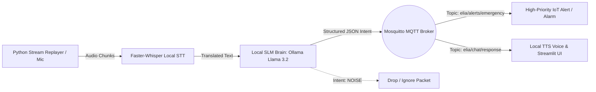

# 1-Page System Design: ELIA Architecture

## 1. End-to-End IoT Data Flow

## 2. Component Breakdown

| Layer | Technology | Role in IoT Pipeline |
| :--- | :--- | :--- |
| **Edge Sensor / Input** | Python Stream Replayer (`soundfile` / `pyaudio`) | Simulates real-time multilingual audio streams in deterministic chunks for repeatable testing. |
| **Perception Layer** | `faster-whisper` (Int8 Quantized) | Converts spoken multilingual audio into English text locally on CPU/GPU. |
| **Cognition Layer** | `Ollama` (`llama3.2:3b`) | Evaluates text context, solves user questions offline, and outputs strict JSON (`intent` + `reply`). |
| **Messaging Layer** | `Eclipse Mosquitto` (MQTT v3.1.1/v5) | Lightweight IoT Pub/Sub broker decoupling AI inference from physical/software actuators. |
| **Actuation Layer** | `pyttsx3` (TTS) + `Streamlit` UI | Speaks assistant responses aloud, displays live chat/telemetry, and logs emergency MQTT triggers. |

## 3. MQTT Topic Hierarchy & Payload Schema
- **`elia/alerts/emergency`** (QoS 2 - High Priority)
  - *Payload:* `{"timestamp": "...", "intent": "EMERGENCY", "transcript": "Help, I fell down!", "priority": "HIGH"}`
- **`elia/chat/response`** (QoS 1 - Standard)
  - *Payload:* `{"timestamp": "...", "intent": "ASSISTANT", "reply": "Here is the solution to your question..."}`
- **`elia/telemetry/status`** (QoS 0 - Heartbeat)
  - *Payload:* `{"status": "ONLINE", "latency_ms": 420}`
